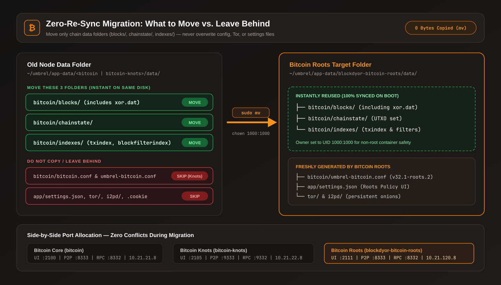
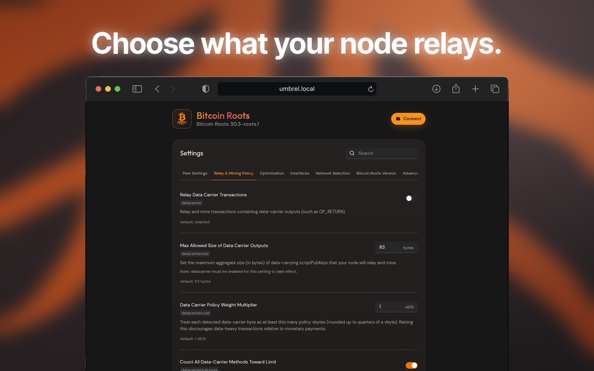
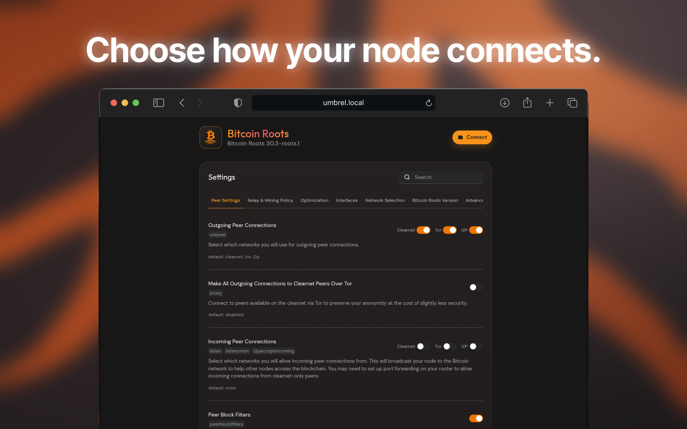

# Migration Guide: Switching to Bitcoin Roots on umbrelOS Without Re-Syncing

This guide walks you through migrating an existing **umbrelOS** node from **Bitcoin Core (`bitcoin`)** or **Bitcoin Knots (`bitcoin-knots`)** to **Bitcoin Roots (`blockdyor-bitcoin-roots`, `v32.1-roots.2`)** with **zero blockchain re-sync**, keeping your old node installed until you have verified everything works, and seamlessly switching all dependent apps (**Core Lightning**, **LND**, **Electrs**, **Fulcrum**, **Public Pool**, **Bassin**, **Mempool**).

> [!IMPORTANT]
> **Why you don't need to uninstall Bitcoin Core or Bitcoin Knots first:**
> `blockdyor-bitcoin-roots` uses dedicated non-colliding host ports and static IPs (`UI :2111`, `P2P :10333`, `RPC :10332`, `Whitebind :10335`, `10.21.120.8-10`) so it installs cleanly side-by-side alongside Bitcoin Core (`8333`/`8332`) and Bitcoin Knots (`9333`/`9332`). Uninstall your old node **only in Step 6** after verifying everything is synced and connected.

---

## Side-by-Side Port & App ID Reference

| App | App ID | Web UI | P2P | RPC | Whitebind | Container IP |
| --- | --- | --- | --- | --- | --- | --- |
| Bitcoin Core | `bitcoin` | `2100` | `8333` | `8332` | `8335` | `10.21.21.8` |
| Bitcoin Knots | `bitcoin-knots` | `2105` | `9333` | `9332` | `9335` | `10.21.22.8` |
| **Bitcoin Roots** | **`blockdyor-bitcoin-roots`** | **`2111`** | **`10333`** | **`10332`** | **`10335`** | **`10.21.120.8`** |

---

## Step 1: Install Bitcoin Roots & Stop Services

> [!NOTE]
> On umbrelOS, the default `umbrel` user does not have permission to access the Docker socket directly. Every `docker` command in this guide must be run with `sudo`.

1. Add the **blockdyor Community App Store** (if you haven't already):
   - Open **App Store → `⋮` (top right) → Community App Stores** and paste:
     ```text
     https://github.com/blockdyor/blockdyor-umbrel-community-app-store
     ```
2. Install **Bitcoin Roots** (`blockdyor-bitcoin-roots`). Because its ports (`10333`/`10332`/`2111`) never collide with Core or Knots, it installs cleanly alongside your current node.
3. Wait until installation finishes, then **stop** these apps from the umbrelOS dashboard (right-click app → **Stop**):
   - **Bitcoin Roots** (`blockdyor-bitcoin-roots`): stop it before it downloads blocks from scratch
   - Your existing node: **Bitcoin Node** (`bitcoin`) or **Bitcoin Knots** (`bitcoin-knots`)
   - Dependent apps: **Core Lightning**, **Lightning Node (LND)**, **Electrs**, **Fulcrum**, **Bassin**, **Public Pool**, **Mempool**

---

## Step 2: Move Only the Blockchain Data (Instant, Zero Copy)

Open a terminal via **SSH** (`ssh umbrel@umbrel.local`) or **umbrelOS → Settings → Advanced → Terminal**.

> [!WARNING]
> **Do NOT `mv` the entire `data/` directory wholesale.**
> Moving the entire `data/` directory copies old `bitcoin.conf` / `umbrel-bitcoin.conf` files (including Knots-only flags such as `softwareexpiry=0` that can stop startup), stale `settings.json` schemas, and old Tor/I2P keys. Move **only** `blocks/` (which contains `xor.dat`), `chainstate/`, and `indexes/`.



> [!TIP]
> **Relocated external storage (umbrelOS 2.0):** If your existing Bitcoin data lives on an external SSD, replace `/home/umbrel/umbrel/app-data/<app>/data/bitcoin` below with the actual path shown under App Settings → Storage so `mv` stays on the same filesystem (instant, 0 bytes copied).

> [!CAUTION]
> **Run all Step 2 commands in the same terminal session.**
> `SRC` and `DST` are shell variables and will be empty if your terminal restarts or you open a new tab. Always check the printed `SRC=` and `DST=` values before running `rm` or `mv`. Writing out the full absolute paths (`/home/umbrel/umbrel/app-data/...`) directly in each command is the safest alternative.

### Option A: Migrating from Bitcoin Core (`bitcoin`)

1. Set paths and confirm both nodes are stopped:
   ```bash
   set -u
   SRC=/home/umbrel/umbrel/app-data/bitcoin/data/bitcoin
   DST=/home/umbrel/umbrel/app-data/blockdyor-bitcoin-roots/data/bitcoin
   echo "SRC=$SRC"
   echo "DST=$DST"

   # Verify both nodes are stopped before touching any files
   RUNNING=$(sudo docker ps --format '{{.Names}}') && {
     echo "$RUNNING" | grep -E 'bitcoin(_app|_bitcoind)|blockdyor-bitcoin-roots_app' || echo "Both nodes stopped, safe to proceed"
   }
   ```
   If you see **any** permission error above the message, the check did not run and you must **not** proceed.

2. Check the source folders, sizes, and filesystem device before moving:
   ```bash
   # Confirm blocks, chainstate, and indexes exist in SRC
   sudo ls -la "$SRC"

   # Confirm sizes look like a full node (e.g., hundreds of GB for blocks)
   sudo du -sh "$SRC/blocks" "$SRC/chainstate" "$SRC/indexes"

   # Confirm SRC and DST are on the same device/filesystem so mv is instant
   df -h "$SRC" "$(dirname "$DST")"
   ```
   - Previous attempts can leave leftover folders such as `blocks.knots-initial-*`, `chainstate.partial-*`, or `indexes.partial-*`. These are small leftovers and must **not** be moved. Only move the plain `blocks`, `chainstate`, and `indexes` folders.
   - Both lines from `df -h` should show the same device (for example `/dev/nvme0n1p2` or `/dev/sda1`). If they differ, `mv` will become a slow copy of hundreds of GB. If `mv` takes more than a few seconds, press `Ctrl+C` and re-read the external storage tip above.

3. Move the chain folders (guarded against empty variables):
   ```bash
   if [ -n "$SRC" ] && [ -n "$DST" ]; then
     sudo rm -rf "$DST/blocks" "$DST/chainstate" "$DST/indexes"
     sudo mkdir -p "$DST"
     sudo mv "$SRC/blocks" "$SRC/chainstate" "$DST/"
     [ -d "$SRC/indexes" ] && sudo mv "$SRC/indexes" "$DST/"
     sudo chown -R 1000:1000 "$DST"
   else
     echo "SRC or DST is empty, stop"
   fi
   ```

### Option B: Migrating from Bitcoin Knots (`bitcoin-knots`)

1. Set paths and confirm both nodes are stopped:
   ```bash
   set -u
   SRC=/home/umbrel/umbrel/app-data/bitcoin-knots/data/bitcoin
   DST=/home/umbrel/umbrel/app-data/blockdyor-bitcoin-roots/data/bitcoin
   echo "SRC=$SRC"
   echo "DST=$DST"

   # Verify both nodes are stopped before touching any files
   RUNNING=$(sudo docker ps --format '{{.Names}}') && {
     echo "$RUNNING" | grep -E 'bitcoin-knots_app|blockdyor-bitcoin-roots_app' || echo "Both nodes stopped, safe to proceed"
   }
   ```
   If you see **any** permission error above the message, the check did not run and you must **not** proceed.

2. Check the source folders, sizes, and filesystem device before moving:
   ```bash
   # Confirm blocks, chainstate, and indexes exist in SRC
   sudo ls -la "$SRC"

   # Confirm sizes look like a full node (e.g., hundreds of GB for blocks)
   sudo du -sh "$SRC/blocks" "$SRC/chainstate" "$SRC/indexes"

   # Confirm SRC and DST are on the same device/filesystem so mv is instant
   df -h "$SRC" "$(dirname "$DST")"
   ```
   - Previous attempts can leave leftover folders such as `blocks.knots-initial-*`, `chainstate.partial-*`, or `indexes.partial-*`. These are small leftovers and must **not** be moved. Only move the plain `blocks`, `chainstate`, and `indexes` folders.
   - Both lines from `df -h` should show the same device. If they differ, `mv` will become a slow copy of hundreds of GB. If `mv` takes more than a few seconds, press `Ctrl+C` and re-read the external storage tip above.

3. Move the chain folders (guarded against empty variables):
   ```bash
   if [ -n "$SRC" ] && [ -n "$DST" ]; then
     sudo rm -rf "$DST/blocks" "$DST/chainstate" "$DST/indexes"
     sudo mkdir -p "$DST"
     sudo mv "$SRC/blocks" "$SRC/chainstate" "$DST/"
     [ -d "$SRC/indexes" ] && sudo mv "$SRC/indexes" "$DST/"
     sudo chown -R 1000:1000 "$DST"
   else
     echo "SRC or DST is empty, stop"
   fi
   ```

### Verify After the Move, Before Starting Bitcoin Roots

Run these checks in the same terminal session before starting Bitcoin Roots:

```bash
# Confirm blocks, chainstate, and indexes are present in DST
sudo ls -la "$DST"

# Confirm sizes match what you saw in SRC
sudo du -sh "$DST/blocks" "$DST/chainstate" "$DST/indexes"

# Confirm xor.dat is present inside blocks/ (required for Roots to read block files)
sudo ls "$DST/blocks" | grep xor
```

- You should see `xor.dat` in the `grep xor` output. Without `xor.dat`, Bitcoin Roots cannot read the moved block files.
- Fresh `bitcoin.conf` and `umbrel-bitcoin.conf` files already sitting in `$DST` are expected and correct.

---

## Step 3: Start Bitcoin Roots & Verify 100% Sync

1. Start **Bitcoin Roots** from the umbrelOS dashboard (or run `sudo umbreld client apps.start.mutate --appId blockdyor-bitcoin-roots`).
2. Follow the startup logs to confirm `bitcoind` loads your existing chainstate immediately without re-downloading:
   ```bash
   sudo docker logs -f blockdyor-bitcoin-roots_app_1 --tail 50
   ```
   - **What a good start looks like:** lines such as `txindex is enabled at height N` and `basic block filter index is enabled at height N`, followed by peers connecting.
   - Repeated `/api/widget/stats` request lines are just the dashboard polling every few seconds and can be ignored. Press `Ctrl+C` to stop following the logs.
   - **Warning signs:** if you see a reindex request, a corruption message, or block height starting at `0`, stop Bitcoin Roots right away and leave the old node folders untouched.
3. Verify sync state directly via RPC:
   ```bash
   sudo docker exec blockdyor-bitcoin-roots_app_1 bitcoin-cli -datadir=/data/bitcoin -rpcport=10332 getblockchaininfo | jq '{chain, blocks, headers, verificationprogress}'
   ```
   - Expected result: `blocks` equals `headers` and `verificationprogress` is close to `1` (e.g. `0.999999`).
   - If `jq` is not installed on your node, drop `| jq ...` and inspect the raw JSON output instead.
4. Open **Bitcoin Roots** from the umbrelOS dashboard. It should show **Synchronized 100%** within a minute or two:


5. *(Optional)* Review your node settings before reconnecting downstream apps:
   - **Settings → Relay & Mining Policy**: configure Roots filtering policies (`datacarrier`, `rejecttokens`, `rejectparasites`, `permitbaremultisig`, `blockmaxweight`, etc.).
     - **LND / Core Lightning users**: keep **RBF enabled** (`mempoolreplacement` not set to `0`) and keep **`anchor` checked in `permitephemeral`** so Lightning channel sweeps and force-close fee bumps are always accepted by your local mempool.
   - **Settings → Advanced**: enable **IPC (Multiprocess)** if you use **Bassin (`blockdyor-bassin`)** for zero-latency Cap'n Proto block templates.
   - **Settings → Optimization**: now that your node is already synced, you can lower `dbcache` (e.g., `128-256 MiB`) and `maxmempool` (e.g., `100-150 MB`) to save extra RAM on Raspberry Pi 5.



---

## Step 4: Switch Connected Apps to Bitcoin Roots

Because `blockdyor-bitcoin-roots` declares `implements: [bitcoin]` and exports the full canonical `APP_BITCOIN_*` contract (`10.21.120.8`, RPC `10332`, Whitebind `10335`, ZMQ `28332-28336`, `.cookie`, and IPC socket), modern **umbrelOS (1.4+ / 2.0)** lets you switch every connected app directly in the UI, with **no manual `settings.yml` or `.env` editing required**.


Switch apps **one at a time** and check each app's logs with `sudo docker logs` before moving to the next one. Recommended order:
1. **Core Lightning** or **Lightning Node (LND)** first
2. **Bassin** and **Public Pool**
3. **Electrs** or **Fulcrum**
4. **Mempool**

For each app:

1. On the umbrelOS dashboard, right-click the app, open its **Settings**, and go to **Connections** (older or newer umbrelOS versions may call this tab **Dependencies**).
2. Select **Bitcoin Roots** (`blockdyor-bitcoin-roots`) as the Bitcoin node.
3. Click **Save**. umbrelOS automatically restarts the app wired to Bitcoin Roots (`10.21.120.8:10332`) with the matching derived RPC credentials.
4. Check that app's logs (see Step 6) to confirm it connected cleanly before switching the next app.

### App-Specific Connection Notes
- **Core Lightning (`core-lightning`)**: once switched under **Connections** (or **Dependencies**), automatically picks up `10.21.120.8:10332` and matching RPC credentials via `exports.sh`.
- **Lightning Node / LND (`lightning`)**: once switched under **Connections** (or **Dependencies**), automatically picks up RPC (`10332`) and ZMQ (`rawblock :28332`, `rawtx :28333`).
- **Bassin (`blockdyor-bassin`)**: automatically discovers Bitcoin Roots' Cap'n Proto IPC socket (`/bitcoin/node.sock`) when IPC is enabled, or falls back seamlessly to RPC (`10332`) + ZMQ (`28334`).
- **Public Pool (`public-pool`)**: automatically connects via RPC (`10332`) and mines block templates using your Bitcoin Roots Relay & Mining Policy rules.
- **Electrs (`electrs`)**: automatically reads Bitcoin Roots' `.cookie` file and connects to whitebind P2P (`10335`) and RPC (`10332`).
- **Fulcrum (`fulcrum`)**: if you previously edited a custom `fulcrum.conf` with a hardcoded IP/port, remove those manual overrides or update them to `10.21.120.8:10332`.
- **Mempool (`mempool`)**: switch its Bitcoin node under **Connections** (or **Dependencies**) after your Lightning and Electrum servers are up.

> [!NOTE]
> **CLI fallback (if you prefer SSH over the dashboard UI):**
> ```bash
> # Repeat for each appId (core-lightning, lightning, electrs, fulcrum, public-pool, blockdyor-bassin, mempool)
> sudo umbreld client apps.setSelectedDependencies.mutate --appId core-lightning --dependencies '{"bitcoin":"blockdyor-bitcoin-roots"}'
> ```

---

## Step 5: Router Port Forwarding (Optional, Incoming Clearnet Only)

If you only use **Tor / I2P** or outbound peers, **skip this step**.

If you want to accept **incoming clearnet peers** (and previously forwarded port `8333` for Core or `9333` for Knots):

1. Open **Bitcoin Roots → Settings → Peer Settings** and toggle **Clearnet** under **Incoming Peer Connections**, then click **Save changes**:



2. Update your router's NAT / port-forwarding rule to translate external TCP **`8333`** to internal TCP **`10333`** on your Umbrel's LAN IP:


---

## Step 6: Post-Migration Health Check & Uninstall Old Node

Verify that Bitcoin Roots and all connected apps are healthy with zero auth or connection errors:

```bash
# 1. Confirm Bitcoin Roots v32.1-roots.2 is synced (note container is _app_1, not _bitcoind_1)
sudo docker exec blockdyor-bitcoin-roots_app_1 bitcoin-cli -datadir=/data/bitcoin -rpcport=10332 getblockchaininfo | jq '{chain, blocks, headers, verificationprogress}'

# 2. Check logs of connected apps (run the ones you have installed)
sudo docker logs blockdyor-bitcoin-roots_app_1 --tail 30
sudo docker logs core-lightning_lightningd_1 --tail 30
sudo docker logs lightning_lnd_1 --tail 30
sudo docker logs blockdyor-bassin_ckpool_1 --tail 30
sudo docker logs public-pool_server_1 --tail 30
sudo docker logs electrs_electrs_1 --tail 30
sudo docker logs fulcrum_fulcrum_1 --tail 30
```

Look for:
- **Zero** `ECONNREFUSED`, `EHOSTUNREACH`, or `401 Unauthorized` errors
- Every Lightning / Electrum / Mining app reporting the **same block height** as Bitcoin Roots

Keep your old **Bitcoin Node** (`bitcoin`) or **Bitcoin Knots** (`bitcoin-knots`) app installed and stopped for a while, and uninstall it from the umbrelOS dashboard only after every connected app has run cleanly on Bitcoin Roots.

*(If anything goes wrong before uninstalling, you can stop Bitcoin Roots and `mv` `blocks/`, `chainstate/`, and `indexes/` back to your old node with zero data loss.)*
