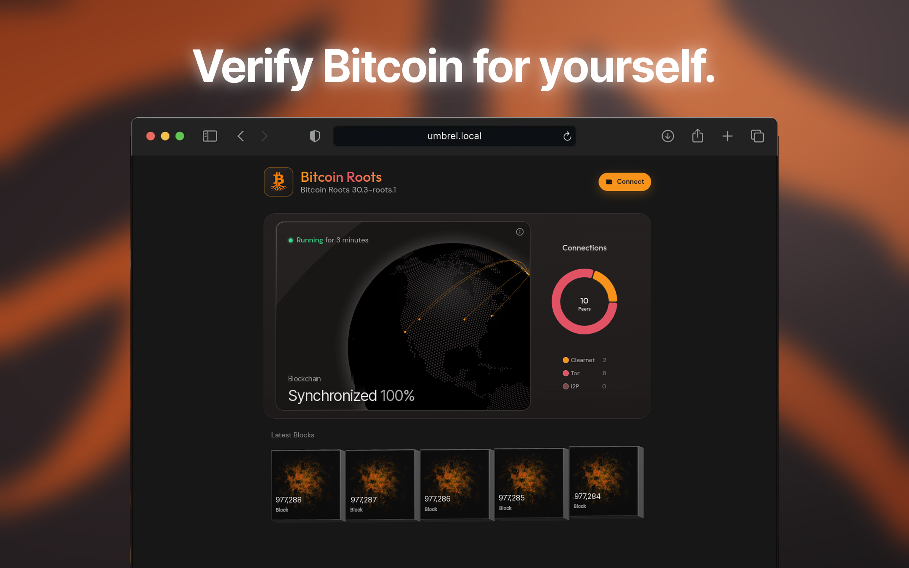
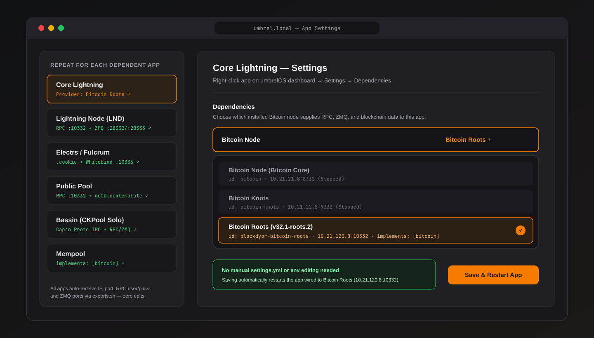
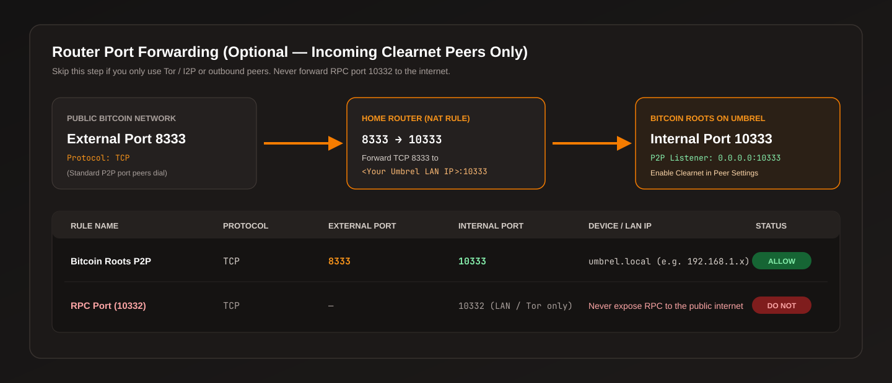

# Migration Guide: Switching to Bitcoin Roots on umbrelOS Without Re-Syncing

This guide walks you through migrating an existing **umbrelOS** node from **Bitcoin Core (`bitcoin`)** or **Bitcoin Knots (`bitcoin-knots`)** to **Bitcoin Roots (`blockdyor-bitcoin-roots`, `v32.1-roots.2`)** with **zero blockchain re-sync** — keeping your old node installed until you have verified everything works, and seamlessly switching all dependent apps (**Core Lightning**, **LND**, **Electrs**, **Fulcrum**, **Public Pool**, **Bassin**, **Mempool**).

> [!IMPORTANT]
> **Why you don't need to uninstall Bitcoin Core or Bitcoin Knots first:**
> `blockdyor-bitcoin-roots` uses dedicated non-colliding host ports and static IPs (`UI :2111`, `P2P :10333`, `RPC :10332`, `Whitebind :10335`, `10.21.120.8–10`) so it installs cleanly side-by-side alongside Bitcoin Core (`8333`/`8332`) and Bitcoin Knots (`9333`/`9332`). Uninstall your old node **only in Step 6** after verifying everything is synced and connected.

---

## Side-by-Side Port & App ID Reference

| App | App ID | Web UI | P2P | RPC | Whitebind | Container IP |
| --- | --- | --- | --- | --- | --- | --- |
| Bitcoin Core | `bitcoin` | `2100` | `8333` | `8332` | `8335` | `10.21.21.8` |
| Bitcoin Knots | `bitcoin-knots` | `2105` | `9333` | `9332` | `9335` | `10.21.22.8` |
| **Bitcoin Roots** | **`blockdyor-bitcoin-roots`** | **`2111`** | **`10333`** | **`10332`** | **`10335`** | **`10.21.120.8`** |

---

## Step 1: Install Bitcoin Roots & Stop Services

1. Add the **blockdyor Community App Store** (if you haven't already):
   - Open **App Store → `⋮` (top right) → Community App Stores** and paste:
     ```text
     https://github.com/blockdyor/blockdyor-umbrel-community-app-store
     ```
2. Install **Bitcoin Roots** (`blockdyor-bitcoin-roots`). Because its ports (`10333`/`10332`/`2111`) never collide with Core or Knots, it installs cleanly alongside your current node.
3. Wait until installation finishes, then **stop** these apps from the umbrelOS dashboard (right-click app → **Stop**):
   - **Bitcoin Roots** (`blockdyor-bitcoin-roots`) — stop it before it downloads blocks from scratch
   - Your existing node: **Bitcoin Node** (`bitcoin`) or **Bitcoin Knots** (`bitcoin-knots`)
   - Dependent apps: **Core Lightning**, **Lightning Node (LND)**, **Electrs**, **Fulcrum**, **Bassin**, **Public Pool**, **Mempool**

---

## Step 2: Move Only the Blockchain Data (Instant, Zero Copy)

Open a terminal via **SSH** (`ssh umbrel@umbrel.local`) or **umbrelOS → Settings → Advanced → Terminal**.

> [!WARNING]
> **Do NOT `mv` the entire `data/` directory wholesale.**
> Moving the entire `data/` directory copies old `bitcoin.conf` / `umbrel-bitcoin.conf` files (including Knots-only flags such as `softwareexpiry=0` that can stop startup), stale `settings.json` schemas, and old Tor/I2P keys. Move **only** `blocks/` (which contains `xor.dat`), `chainstate/`, and `indexes/`.


> [!TIP]
> **Relocated external storage (umbrelOS 2.0):** If your existing Bitcoin data lives on an external SSD, replace `~/umbrel/app-data/<app>/data/bitcoin` below with the actual path shown under App Settings → Storage so `mv` stays on the same filesystem (instant, 0 bytes copied).

### Option A — Migrating from Bitcoin Core (`bitcoin`)

```bash
SRC=~/umbrel/app-data/bitcoin/data/bitcoin
DST=~/umbrel/app-data/blockdyor-bitcoin-roots/data/bitcoin

# Verify both nodes are stopped before moving files
docker ps --format '{{.Names}}' | grep -E 'bitcoin(_app|_bitcoind)|blockdyor-bitcoin-roots_app' || echo "Both nodes stopped — safe to proceed"

# Clear any fresh empty chain folders created on initial install
sudo rm -rf "$DST/blocks" "$DST/chainstate" "$DST/indexes"
sudo mkdir -p "$DST"

# Move blockchain data (includes xor.dat inside blocks/)
sudo mv "$SRC/blocks" "$SRC/chainstate" "$DST/"
[ -d "$SRC/indexes" ] && sudo mv "$SRC/indexes" "$DST/"

# Ensure UID 1000:1000 ownership for the non-root Bitcoin Roots container
sudo chown -R 1000:1000 "$DST"
```

### Option B — Migrating from Bitcoin Knots (`bitcoin-knots`)

```bash
SRC=~/umbrel/app-data/bitcoin-knots/data/bitcoin
DST=~/umbrel/app-data/blockdyor-bitcoin-roots/data/bitcoin

# Verify both nodes are stopped before moving files
docker ps --format '{{.Names}}' | grep -E 'bitcoin-knots_app|blockdyor-bitcoin-roots_app' || echo "Both nodes stopped — safe to proceed"

# Clear any fresh empty chain folders created on initial install
sudo rm -rf "$DST/blocks" "$DST/chainstate" "$DST/indexes"
sudo mkdir -p "$DST"

# Move blockchain data (includes xor.dat inside blocks/)
sudo mv "$SRC/blocks" "$SRC/chainstate" "$DST/"
[ -d "$SRC/indexes" ] && sudo mv "$SRC/indexes" "$DST/"

# Ensure UID 1000:1000 ownership for the non-root Bitcoin Roots container
sudo chown -R 1000:1000 "$DST"
```

---

## Step 3: Start Bitcoin Roots & Verify 100% Sync

1. Start **Bitcoin Roots** from the umbrelOS dashboard (or run `sudo umbreld client apps.start.mutate --appId blockdyor-bitcoin-roots`).
2. Watch the startup logs to confirm `bitcoind` loads your existing chainstate immediately without re-downloading:
   ```bash
   docker logs blockdyor-bitcoin-roots_app_1 --tail 50
   ```
3. Open **Bitcoin Roots** from the umbrelOS dashboard — it should show **Synchronized 100%** within a minute or two:



4. *(Optional)* Review your node settings before reconnecting downstream apps:
   - **Settings → Relay & Mining Policy**: configure Roots filtering policies (`datacarrier`, `rejecttokens`, `rejectparasites`, `permitbaremultisig`, `blockmaxweight`, etc.).
     - **LND / Core Lightning users**: keep **RBF enabled** (`mempoolreplacement` not set to `0`) and keep **`anchor` checked in `permitephemeral`** so Lightning channel sweeps and force-close fee bumps are always accepted by your local mempool.
   - **Settings → Advanced**: enable **IPC (Multiprocess)** if you use **Bassin (`blockdyor-bassin`)** for zero-latency Cap'n Proto block templates.
   - **Settings → Optimization**: now that your node is already synced, you can lower `dbcache` (e.g., `128–256 MiB`) and `maxmempool` (e.g., `100–150 MB`) to save extra RAM on Raspberry Pi 5.


---

## Step 4: Switch Dependent Apps to Bitcoin Roots

Because `blockdyor-bitcoin-roots` declares `implements: [bitcoin]` and exports the full canonical `APP_BITCOIN_*` contract (`10.21.120.8`, RPC `10332`, Whitebind `10335`, ZMQ `28332–28336`, `.cookie`, and IPC socket), modern **umbrelOS (1.4+ / 2.0)** lets you switch every dependent app directly in the UI — **no manual `settings.yml` or `.env` editing required**.



For **each** dependent app (**Core Lightning**, **Lightning Node (LND)**, **Electrs**, **Fulcrum**, **Public Pool**, **Bassin**, **Mempool**):

1. On the umbrelOS dashboard, **right-click the app → Settings → Dependencies**.
2. Under **Bitcoin Node**, select **Bitcoin Roots** (`blockdyor-bitcoin-roots`).
3. Click **Save** — umbrelOS automatically restarts the app wired to Bitcoin Roots (`10.21.120.8:10332`) with the matching derived RPC credentials.

### App-Specific Notes
- **Core Lightning (`core-lightning`)**: automatically picks up `10.21.120.8:10332` and matching RPC credentials via `exports.sh`.
- **Lightning Node / LND (`lightning`)**: automatically picks up RPC (`10332`) and ZMQ (`rawblock :28332`, `rawtx :28333`).
- **Electrs (`electrs`)**: automatically reads Bitcoin Roots' `.cookie` file and connects to whitebind P2P (`10335`) and RPC (`10332`).
- **Fulcrum (`fulcrum`)**: if you previously edited a custom `fulcrum.conf` with a hardcoded IP/port, remove those manual overrides or update them to `10.21.120.8:10332`.
- **Bassin (`blockdyor-bassin`)**: automatically discovers Bitcoin Roots' Cap'n Proto IPC socket (`/bitcoin/node.sock`) when IPC is enabled, or falls back seamlessly to RPC (`10332`) + ZMQ (`28334`).
- **Public Pool (`public-pool`)**: automatically connects via RPC (`10332`) and mines block templates using your Bitcoin Roots Relay & Mining Policy rules.

> [!NOTE]
> **CLI fallback (if you prefer SSH over the dashboard UI):**
> ```bash
> # Repeat for each appId (core-lightning, lightning, electrs, fulcrum, public-pool, blockdyor-bassin, mempool)
> sudo umbreld client apps.setSelectedDependencies.mutate --appId core-lightning --dependencies '{"bitcoin":"blockdyor-bitcoin-roots"}'
> ```

---

## Step 5: Router Port Forwarding (Optional — Incoming Clearnet Only)

If you only use **Tor / I2P** or outbound peers, **skip this step**.

If you want to accept **incoming clearnet peers** (and previously forwarded port `8333` for Core or `9333` for Knots):

1. Open **Bitcoin Roots → Settings → Peer Settings** and toggle **Clearnet** under **Incoming Peer Connections**, then click **Save changes**:


2. Update your router's NAT / port-forwarding rule to translate external TCP **`8333`** to internal TCP **`10333`** on your Umbrel's LAN IP:



---

## Step 6: Post-Migration Health Check & Uninstall Old Node

Verify that Bitcoin Roots and all connected apps are healthy with zero auth or connection errors:

```bash
# 1. Confirm Bitcoin Roots v32.1-roots.2 is synced (note container is _app_1, not _bitcoind_1)
docker exec blockdyor-bitcoin-roots_app_1 bitcoin-cli -datadir=/data/bitcoin -rpcport=10332 getblockchaininfo | jq '{chain, blocks, headers, verificationprogress}'

# 2. Check logs of connected apps (run the ones you have installed)
docker logs blockdyor-bitcoin-roots_app_1 --tail 30
docker logs core-lightning_lightningd_1 --tail 30
docker logs lightning_lnd_1 --tail 30
docker logs electrs_electrs_1 --tail 30
docker logs fulcrum_fulcrum_1 --tail 30
docker logs blockdyor-bassin_ckpool_1 --tail 30
docker logs public-pool_server_1 --tail 30
```

Look for:
- **Zero** `ECONNREFUSED`, `EHOSTUNREACH`, or `401 Unauthorized` errors
- Every Lightning / Electrum / Mining app reporting the **same block height** as Bitcoin Roots

Once everything is verified and running smoothly:
- Open the umbrelOS dashboard, right-click your old **Bitcoin Node** (`bitcoin`) or **Bitcoin Knots** (`bitcoin-knots`) app, and click **Uninstall**.
- *(If anything went wrong before uninstalling, you can simply stop Bitcoin Roots and `mv` `blocks/`, `chainstate/`, and `indexes/` right back to your old node — zero data loss!)*
